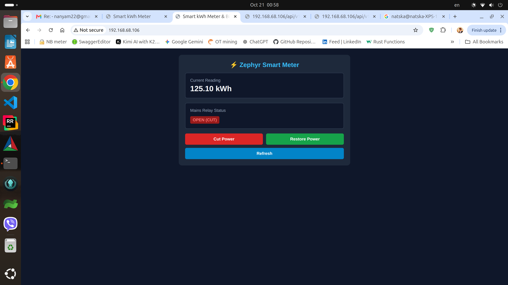
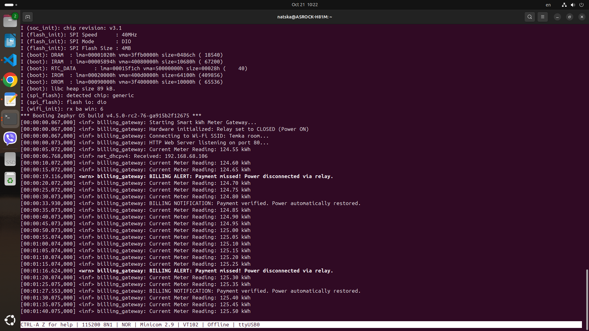

## About   Author Natska Natsgnyam NAMKHAI 
# ⚡ Zephyr RTOS Smart kWh Meter & Billing Gateway

A production-grade, zero-allocation embedded IoT billing gateway and smart meter application engineered for the **ESP32-WROOM-32E** module running **Zephyr RTOS**. 

Designed with a first-principles embedded engineering mindset, this project features lock-free producer-consumer ring buffers, cache-line isolation, POSIX/BSD socket networking, REST JSON APIs, and a responsive embedded single-page web dashboard.

---
 
 

 
 


## 🚀 Key Features

* **Real-Time Telemetry & Simulation:** Background sampling thread producing incremental kWh data stored in a static ring buffer.
* **Mains Power Cutoff Control:** GPIO 4 output controlling a simulated mains power relay (`/api/v1/relay/cut` and `/api/v1/relay/restore`).
* **Embedded Web Dashboard:** A self-contained, responsive single-page web interface served directly from flash memory over HTTP port 80.
* **REST JSON API:** Programmatic telemetry endpoints (`/api/v1/meter`) fully compatible with automation scripts, OpenAPI 3.0 specs, and external clients.
* **Robust Socket Architecture:** Optimized TCP connection teardown (`Connection: close`, `zsock_shutdown`, receive timeouts) preventing socket exhaustion under heavy browser polling.

---

## 🛠️ Architecture & Engineering Rules

* **Zero Dynamic Memory Allocation:** Entirely static memory pools (`CONFIG_HEAP_MEM_POOL_SIZE`) eliminating heap fragmentation.
* **Cache-Line Isolation:** Control structures utilize explicit 64-byte alignment (`__attribute__((aligned(64)))`) with padding to prevent false sharing and atomic conflicts between threads.
* **Bitwise Ring Buffer Masking:** Zero modulo (`%`) overhead, utilizing fast bitwise AND masking (`& (RING_BUFFER_SIZE - 1)` where size is a power of 2).

---

## 📂 Project Structure

```text
smart_meter_gateway/
├── CMakeLists.txt        # Build configuration
├── prj.conf              # Zephyr Kconfig subsystem settings
├── openapi.yaml          # OpenAPI 3.0 REST contract specification
├── README.md             # Project documentation
└── src/
    └── main.c            # Core application, Wi-Fi mgmt, ring buffer, and HTTP server


⚙️ Building & Flashing
Prerequisites
Zephyr RTOS SDK (v4.5.0 or compatible)

Python virtual environment (zephyr-env) configured with west and esptool.

Build
Bash
west build -pr pristine -s smart_meter_gateway -b esp32_devkitc/esp32/procpu -d build_smart_meter
Flash
Bash
west flash -d build_smart_meter


🌐 Endpoints & API Reference
GET / — Serves the interactive web dashboard.

GET /api/v1/meter — Returns current meter reading and relay status in JSON.

GET /api/v1/relay/cut — Disconnects mains power (sets GPIO 4 LOW).

GET /api/v1/relay/restore — Restores mains power (sets GPIO 4 HIGH).
EOF


