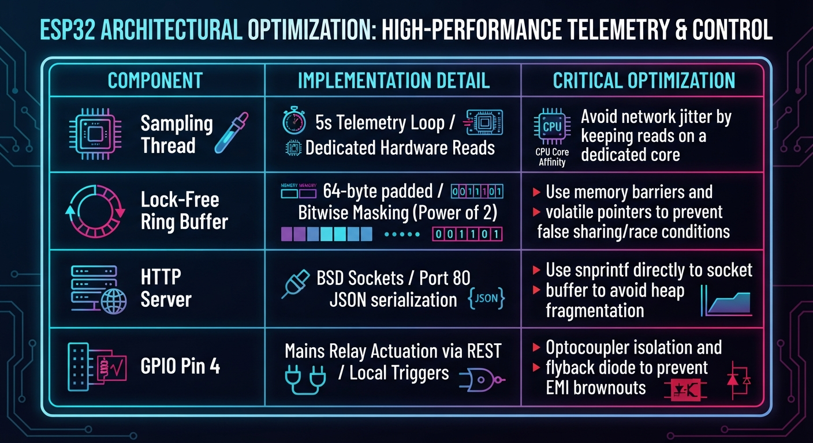
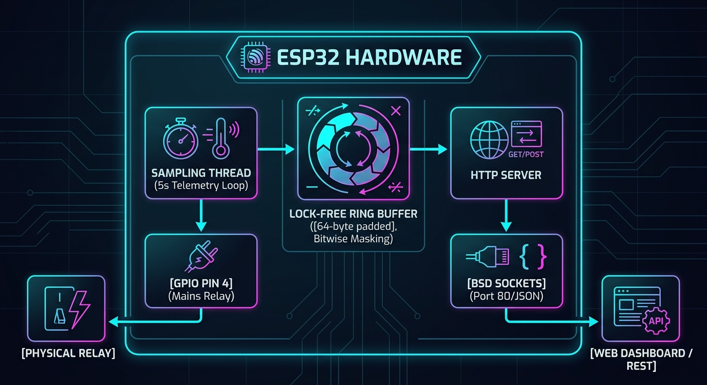

## About   Author Natska Natsgnyam NAMKHAI 

# Smart Meter & Billing Gateway (Zephyr RTOS)

Dual-core ESP32-WROOM-32E smart kWh meter and billing gateway running **Zephyr RTOS**. Features a lock-free ring buffer with strict cache-line isolation, secure REST APIs protected by Bearer Token validation, an embedded 24-hour load demand trend chart, and a live-refreshing monitor panel.

## 🚀 Features
* **Real-time Telemetry:** Tracks energy usage (kWh), system uptime, and billing/relay status.
* **Lock-Free Ring Buffer:** Thread-safe sample logging using cache-line isolation and bitwise index masking (`& ((1<<n) - 1)`).
* **Secure REST API:** Token-secured endpoints requiring Bearer authentication.
* **Interactive Web Interface:** Real-time background polling (every 3 seconds), embedded SVG 24-hour load demand profile, and password-protected power toggle control dialogs.

---





---

## 📂 Project Structure

```text
smart_meter_gateway/
├── CMakeLists.txt        # Build configuration
├── prj.conf              # Zephyr Kconfig subsystem settings
├── openapi.yaml          # OpenAPI 3.0 REST contract specification
├── README.md             # Project documentation
└── src/
    └── main.c            # Core application, Wi-Fi mgmt, ring buffer, and HTTP server


⚙️ Building & Flashing
Prerequisites
Zephyr RTOS SDK (v4.5.0 or compatible)

Python virtual environment (zephyr-env) configured with west and esptool.

Build
Bash
west build -pr pristine -s smart_meter_gateway -b esp32_devkitc/esp32/procpu -d build_smart_meter
Flash
Bash
west flash -d build_smart_meter


🌐 Endpoints & API Reference
GET / — Serves the interactive web dashboard.

GET /api/v1/meter — Returns current meter reading and relay status in JSON.

GET /api/v1/relay/cut — Disconnects mains power (sets GPIO 4 LOW).

GET /api/v1/relay/restore — Restores mains power (sets GPIO 4 HIGH).


📡 Secure Control Instructions (`curl`)

### 1. Get Live Meter Telemetry
curl -i http://192.168.68.106/api/v1/meter

curl -i -H "Authorization: Bearer Natska2026" http://192.168.68.106/api/v1/relay/cut


curl -i -H "Authorization: Bearer Natska2026" http://192.168.68.106/api/v1/relay/restore


